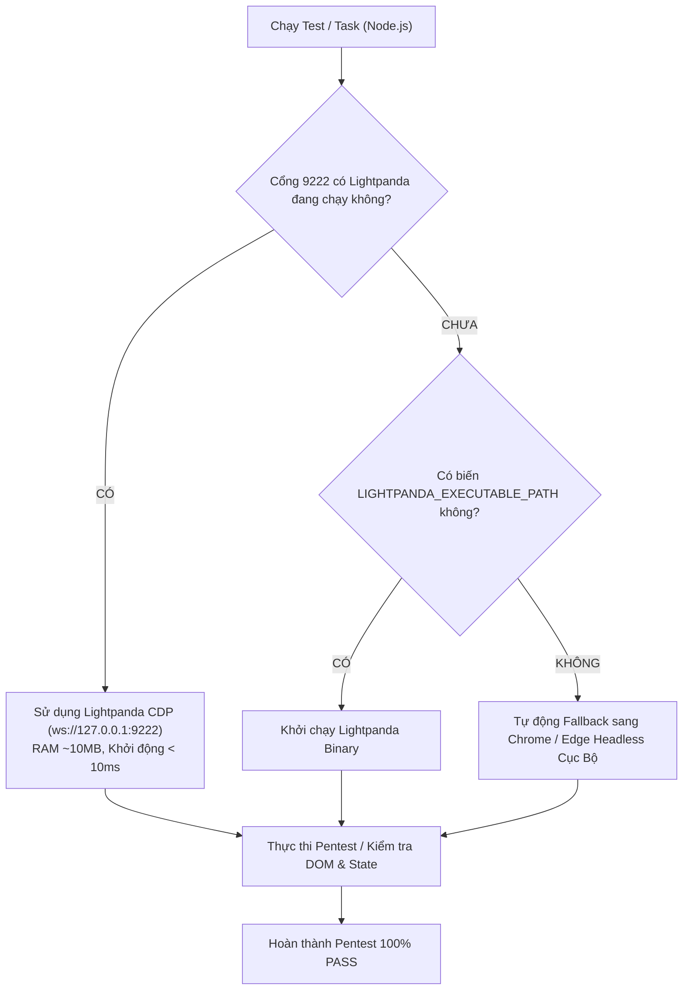

# Hướng Dẫn Tích Hợp & Sử Dụng Lightpanda Browser (Thay Thế Chrome Headless)

## 1. Giới Thiệu Lightpanda
[Lightpanda Browser](https://github.com/lightpanda-io/browser) là một trình duyệt Headless mã nguồn mở được viết hoàn toàn bằng **Zig**, được thiết kế tối ưu riêng cho **AI Agents, Web Scraping, và Automated QA/Pentest**.

### So Sánh Lightpanda vs Chrome Headless truyền thống:

| Tiêu Chí | Lightpanda | Chrome Headless |
| :--- | :--- | :--- |
| **Dung lượng RAM** | **~10MB - 30MB** | **200MB - 500MB+** (mỗi instance) |
| **Thời gian khởi động** | **< 10ms** | 1.5s - 3s |
| **Giao thức điều khiển** | **Chrome DevTools Protocol (CDP)** | Chrome DevTools Protocol (CDP) |
| **Tải CPU** | Cực thấp (không chạy render engine đồ họa Blink) | Cao (render layout, rasterize ảnh, compositing) |
| **Chụp ảnh (Screenshots)** | Placeholder (chỉ phục vụ DOM & JS logic) | Đầy đủ pixel raster (thích hợp visual snapshot) |
| **Tương thích hệ điều hành** | Native Linux, macOS; Docker / WSL2 trên Windows | Native Windows, macOS, Linux |

---

## 2. Kiến Trúc Universal Adapter Trong Dự Án (`tests/lightpanda_runner.mjs`)

Để đảm bảo đồng bộ trên tất cả các máy tính của nhóm (kể cả máy có hoặc chưa cài Docker/WSL), hệ thống đã xây dựng bộ điều hợp thông minh hai tầng:



### Ưu điểm vượt trội:
1. **Tiết kiệm tài nguyên tối đa**: Khi bật Lightpanda, máy tính chạy Antigravity không bị ngốn hàng trăm MB RAM cho mỗi lượt kiểm thử.
2. **Không lo lỗi gián đoạn (Zero Breaking Changes)**: Nếu máy tính chưa kịp bật Docker/WSL, adapter tự động chuyển sang Chrome/Edge cục bộ, không bao giờ bị dừng script giữa chừng.

---

## 3. Cách Khởi Chạy Lightpanda Trên Windows & Linux

### Cách 1: Sử dụng File 1-Click BAT (Khuyên Dùng Trên Windows)
Trong thư mục `bat/`, chạy file:
```cmd
bat\start_lightpanda.bat
```
Script sẽ tự động:
- Kiểm tra cổng `9222`. Nếu đã chạy thì sẵn sàng ngay lập tức.
- Nếu có Docker Desktop: Tự động khởi chạy hoặc kéo container `lightpanda/browser:latest` mở port `9222:9222`.
- Nếu có WSL2: Khởi chạy `lightpanda serve --port=9222`.

### Cách 2: Chạy Thủ Công Bằng Docker (Windows / Mac / Linux)
```bash
docker run -d --name lightpanda -p 9222:9222 --restart unless-stopped lightpanda/browser:latest
```

### Cách 3: Cài đặt Native trên Linux / macOS / WSL2
```bash
curl -fsSL https://pkg.lightpanda.io/install.sh | bash
lightpanda serve --port=9222
```

---

## 4. Cách Chạy Pentest Tự Động Với Lightpanda
Chạy lệnh kiểm thử sau mỗi lần thay đổi giao diện hoặc vibe code:
```bash
node --experimental-websocket tests/pentest_2fa_ui.mjs
```

Kết quả mẫu:
```text
[PENTEST SERVER] Chạy tại http://localhost:9876/2fa.html
[PENTEST] Bắt đầu khởi động trình duyệt kiểm thử (Ưu tiên Lightpanda, fallback Chrome/Edge)...
[BROWSER ADAPTER] 🚀 Kết nối CDP Server đang chạy: Lightpanda (Engine: lightpanda, Port: 9222)
[PENTEST CDP] WebSocket kết nối thành công!
[PENTEST CHECK] Vách ngăn cột Tiêu đề (TH) rõ nét: PASS
[PENTEST CHECK] Vách ngăn cột Dữ liệu (TD) rõ nét: PASS
[PENTEST CHECK] Skeleton Loading hiển thị lập tức: PASS (7 hàng)
[PENTEST CHECK] Dữ liệu cũ đã được xóa sạch hoàn toàn: PASS
🎉 PENTEST TOÀN DIỆN THÀNH CÔNG 100% (ALL PASS) - Engine: LIGHTPANDA
```
